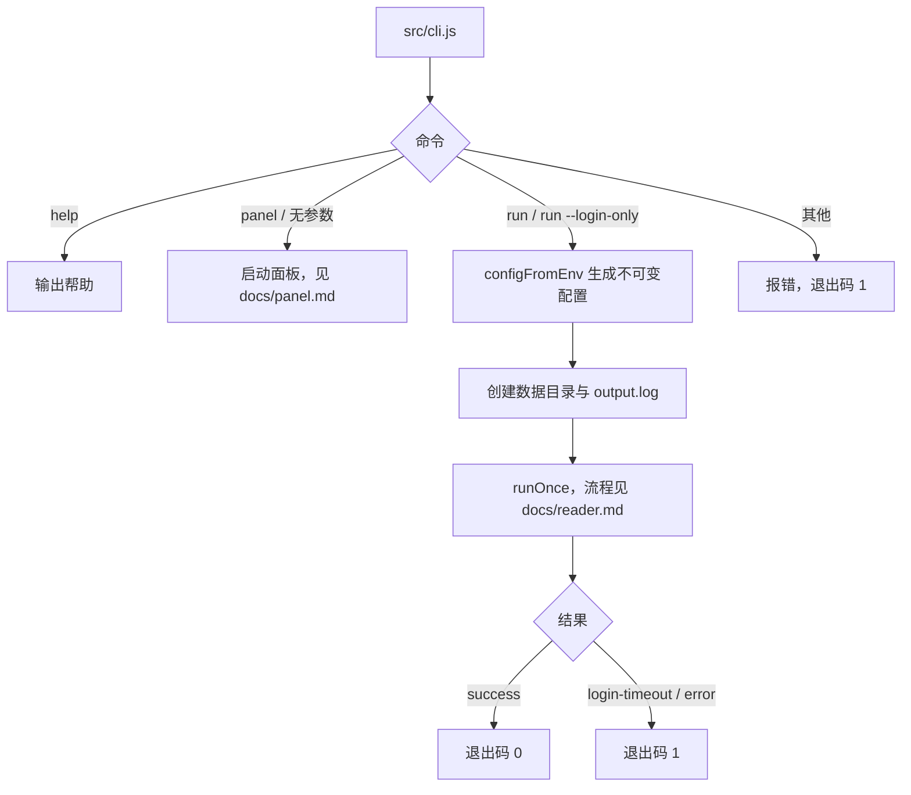

## CLI 说明

> `run` 目前按环境变量运行，是面板完成前的临时入口。开发计划第 4 步改为 `run --account <id>`，按面板中的账号配置运行，届时同步更新本文。面板的配置与接口见 `docs/panel.md`。

### 职责

| 命令 | 职责 | 输入 | 输出 | 关键约束 |
| --- | --- | --- | --- | --- |
| `run` | 执行一次自动阅读 | 环境变量 | 控制台日志、`<数据目录>/output.log`、cookies、登录二维码、截图、通知 | 只连接 `SELENIUM_URL` 指向的远程 Chromium |
| `run --login-only` | 只登录（需要时扫码）并保存 cookies | 环境变量 | 同上，不选书、不阅读 | 用于刷新登录态 |
| `panel` / 无参数 | 启动 Web 面板 | `PANEL_*` 环境变量、`--port` | HTTP 服务、`<面板数据目录>/panel.log` | 镜像默认命令；端口被占用时报错退出 |
| `help` / `-h` / `--help` | 输出帮助与环境变量清单 | 无 | 帮助文本 | 不启动浏览器 |

### 配置

环境变量与配置项一一对应，清单以 `src/config/schema.js` 为准，`help` 输出同一份清单。未设置或为空的变量使用默认值。

相对上游的变化：

| 上游变量 | 现状 |
| --- | --- |
| `WEREAD_REMOTE_BROWSER` | 改名为 `SELENIUM_URL`，默认 `http://selenium:4444` |
| `WEREAD_BROWSER` | 删除，只支持 Chromium |
| `WEREAD_AGREE_TERMS` | 删除，不再上报使用统计 |
| `WEREAD_DATA_DIR` | 默认 `data`（相对当前目录，镜像内为 `/app/data`），不再自动沿用 `.weread` 或旧版 `data` 目录 |
| `run` 的 `--weread-*` 参数 | 删除，只读环境变量 |
| `WEREAD_SPEED` | 含义改为两次翻动之间的间隔，见 `docs/reader.md` |
| 新增 `WEREAD_LOGIN_TIMEOUT` | 等待扫码的总时长（分钟），默认 15 |
| 新增 `WEREAD_ACCOUNT_NAME` | 显示在通知标题中的账号名称 |
| 新增 `NOTIFY_ON_*` | 各通知事件的开关，见 `docs/notifications.md` |

### 流程

### 关键约束

| 约束 | 说明 |
| --- | --- |
| 只用远程浏览器 | 不在本机启动浏览器；本地开发同样需要一个 Selenium 服务或 chromedriver |
| 退出码 | `run` 成功时为 0；等待扫码超时、运行出错、命令或参数错误时为 1 |
| 配置不可变 | 每次运行生成一份冻结的配置对象，各模块通过参数接收，不再读写模块级变量 |
| 不上报 | 不向任何服务器发送使用数据 |
