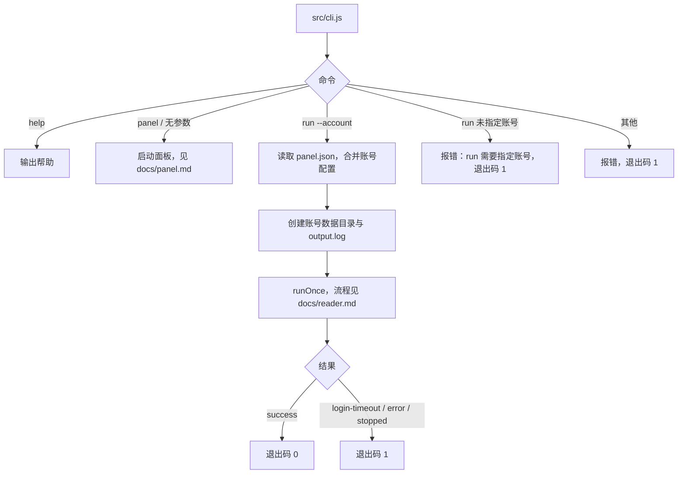

## CLI 说明

> 唯一入口为 `src/cli.js`。阅读配置、通知与调度都在面板中设置，见 `docs/panel.md`；`run --account <id>` 按面板中保存的账号配置在命令行运行一次，用于调试。上游按环境变量运行的方式已删除。

### 职责

| 命令 | 职责 | 输入 | 输出 | 关键约束 |
| --- | --- | --- | --- | --- |
| `panel` / 无参数 | 启动 Web 面板 | `PANEL_*` 与 `SELENIUM_URL` 环境变量 | HTTP 服务、`<面板数据目录>/panel.log` | 镜像默认命令；不接受额外参数；端口被占用时报错退出 |
| `run --account <id>` | 按面板中的账号配置执行一次自动阅读 | `PANEL_DATA_DIR` 下的 `panel.json` | 控制台日志、`accounts/<id>/` 下的 `output.log`、cookies、登录二维码、截图、通知 | 账号覆盖 > 全局默认 > 内置默认；不读取运行相关的环境变量；只读 `panel.json`；不检查面板是否正在运行同一账号，两边会同时写 cookies 与截图，调试前先在面板中停止该账号的运行 |
| `--login-only` | 与 `run --account` 搭配，只登录（需要时扫码）并保存 cookies | 同上 | 同上，不选书、不阅读 | 用于刷新登录态 |
| `help` / `-h` / `--help` | 输出帮助与面板环境变量清单 | 无 | 帮助文本 | 不启动浏览器 |

### 配置

容器与命令行只读取 `PANEL_*` 与 `SELENIUM_URL` 环境变量（见 `docs/panel.md`“配置”）；阅读、浏览器、通知等运行配置全部在面板中设置，清单以 `src/config/schema.js` 为准。

运行配置在面板接口中按清单校验，非法时返回 400：整数必须是完整的十进制数（`10abc` 不接受）且在安全整数范围内；阅读时长、等待扫码时长在 1–1440 分钟之间；SMTP 端口在 1–65535 之间；选书方式只能是 -1 到 4；阅读速度只能是 `slow`、`normal`、`fast`；布尔值只接受 `true/false`、`1/0`、`yes/no`、`y/n`、`on/off`。`PANEL_PORT` 等面板环境变量非法时，启动直接报错并以退出码 1 结束。

相对上游的变化：

| 上游 | 现状 |
| --- | --- |
| 按环境变量运行（`node src/cli.js run`、`app.js`、`schedule` 子命令） | 删除。账号与配置在面板中创建，由面板调度运行；命令行只保留 `run --account <id>` |
| `WEREAD_*`、`BARK_*`、`NTFY_*`、`EMAIL_*` 等环境变量 | 改为面板中的运行配置（全局默认 + 账号覆盖），配置项名称见 `src/config/schema.js` |
| `WEREAD_REMOTE_BROWSER` | 改为面板中的 Selenium 地址；首次启动面板时取 `SELENIUM_URL` |
| `WEREAD_BROWSER` | 删除，只支持 Chromium |
| `WEREAD_AGREE_TERMS` | 删除，不再上报使用统计 |
| `WEREAD_DATA_DIR` | 由面板数据目录（`PANEL_DATA_DIR`，默认 `data`）取代，每个账号的数据在 `accounts/<id>/` |
| `WEREAD_SPEED` | 阅读速度含义改为两次翻动之间的间隔，见 `docs/reader.md` |
| 新增 | 等待扫码时长、各通知事件的开关（见 `docs/notifications.md`）、调度规则（见 `docs/panel.md`“调度”） |

### 流程

### 关键约束

| 约束 | 说明 |
| --- | --- |
| 只用远程浏览器 | 不在本机启动浏览器；本地开发同样需要一个 Selenium 服务或 chromedriver |
| 退出码 | `run` 成功时为 0；等待扫码超时、运行出错、被停止、命令或参数错误、未指定账号、账号不存在或已停用、面板数据不存在时为 1 |
| 停止信号 | `run` 收到 SIGTERM（`docker stop`）或 SIGINT（Ctrl+C）时先关闭浏览器再退出，不发送失败通知；在容器中作为 1 号进程运行时也能及时响应 |
| 日志完整 | 退出前等待日志文件写入完成，`output.log` 包含最后的 `Run finished` 行 |
| 配置不可变 | 每次运行生成一份冻结的配置对象，各模块通过参数接收，不再读写模块级变量 |
| 配置校验 | 拼写错误或超出范围的取值不会被悄悄改成默认值或截断，而是报错，见 `cases/config.md` |
| 不上报 | 不向任何服务器发送使用数据 |
