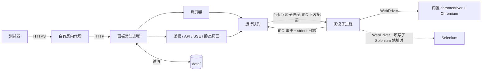
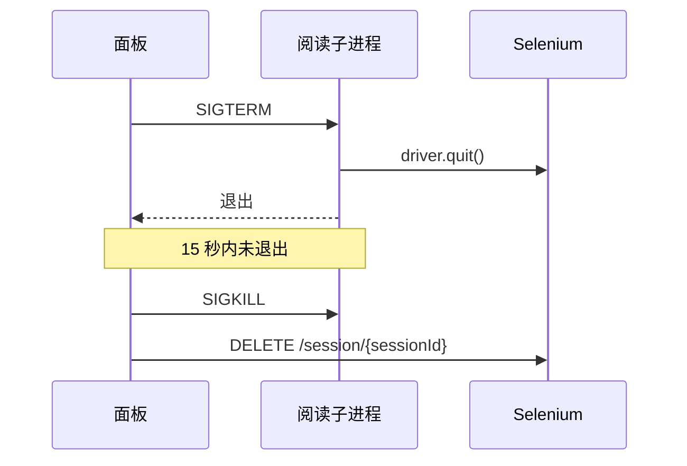

## WeReadAssistant 设计

> 状态：已按"开发顺序"全部实现，0.1.0 为第一个发布版本。本文保留当时的设计与取舍；各模块的现行行为以 `docs/panel.md`、`docs/reader.md`、`docs/cli.md`、`docs/notifications.md` 为准，验收用例见 `cases/`。

### 目标与范围

基于 [jqknono/weread-challenge-selenium](https://github.com/jqknono/weread-challenge-selenium) 的新产品：以 Docker 部署在树莓派等 arm64 设备上，通过常驻的 Web 管理面板完成多账号管理、配置、调度、扫码登录和运行监控。不兼容上游的命令、入口和目录结构，也不提供旧数据导入，账号首次运行时扫码登录。

| 范围 | 内容 |
| --- | --- |
| 包含 | 多账号；配置编辑（全局 + 账号覆盖）；面板内调度；运行队列；立即运行 / 仅登录 / 停止；面板内扫码登录；实时日志与截图；运行历史；打卡日历；Selenium 状态；可选 noVNC 实时画面链接；对上游阅读流程的修复与重构 |
| 不包含 | 读取微信读书官方数据（真实阅读时长、挑战进度）；PWA；Docker 之外的运行方式；Chromium 之外的浏览器；使用统计上报 |

### 已确认的决策

| 决策 | 结论 |
| --- | --- |
| 产品名 | WeReadAssistant；仓库 `Weread-Assistant`，镜像名 `weread-assistant`（镜像名只能小写）；README 开头声明非官方、与腾讯无关 |
| 仓库 | 私有仓库 `lonemoonspace/Weread-Assistant`，全新历史，第一版可用后公开；README 致谢上游，LICENSE 保留上游版权声明 |
| 分发 | 只发布 `linux/arm64` Docker 镜像 `lonemoonspace/weread-assistant` |
| 浏览器 | 默认使用镜像内置的 Chromium 与 chromedriver（无界面模式，阅读子进程在容器内启动）；也可以连接自己部署的 Selenium（如 `selenium/standalone-chromium`）。第 11 步之前只支持 Selenium |
| 统计上报 | 删除，不向任何服务器发送使用数据 |
| 兼容性 | 不保留上游的 CLI 命令名、`app.js` 入口、`schedule` 子命令和旧数据目录；不提供旧数据导入，账号首次运行时扫码登录 |
| 调度 | 面板常驻并负责调度，不再使用宿主 crontab |
| 账号 | 支持多账号 |
| 前端 | Vue 3 全局构建版，免构建，依赖文件放在仓库内 |
| 访问方式 | 外网访问，经使用者自有的反向代理（Nginx / frp / Cloudflare Tunnel 等）提供 HTTPS |
| 阅读截图 | 继续每分钟截图，历史只保留最近 3 次运行的截图，可在设置中调整 |
| 端口 | 默认 `26868` |

### 架构



- 每次阅读都是一个独立的子进程（`child_process.fork`，单独的进程组）。浏览器卡死或崩溃不影响面板；内置浏览器的进程在子进程的进程组中，子进程退出后由面板结束剩下的进程。
- 子进程通过 IPC 接收本次运行的配置对象，不经环境变量传递，密钥不出现在进程环境中。
- 子进程通过 IPC 事件上报状态，日志取自子进程 stdout。运行结果以事件为准：退出前未收到 `done` 即判定失败。
- 面板启动时把上次遗留的"运行中"记录标为"中断"。

### 职责

| 组件 | 职责 | 关键约束 |
| --- | --- | --- |
| `src/cli.js` | 唯一入口：`panel`（默认）启动面板；`run --account <id>` 按面板配置单次运行一个账号，用于调试 | 镜像 `CMD` 为 `panel` |
| `src/config/schema.js` | 配置项清单：中文名称、分组、类型、可选值、默认值、是否密钥 | 面板表单与配置校验都由它生成 |
| `src/config/resolve.js` | 默认值 + 全局配置 + 账号覆盖 → 本次运行的配置对象 | 返回不可变对象，替代上游的模块级可变变量 |
| `src/reader/worker.js` | 阅读子进程入口：接收配置、执行一次阅读、上报事件、处理停止信号 | 只由面板 fork；`run --account` 在进程内直接调用 `run.js` |
| `src/reader/run.js` | 单次运行编排：连接浏览器、登录、选书、阅读，并在各阶段发送通知 | 由 `worker.js` 调用，不直接退出进程 |
| `src/reader/browser.js` | 启动内置浏览器或连接 Selenium、设置超时、退出时清理会话 | 只支持 Chromium |
| `src/reader/login.js` | 登录检测、二维码解析与刷新、cookies 读写 | cookies 原子写入，损坏时转入扫码 |
| `src/reader/reading.js` | 选书、切换滚动模式、阅读循环 | 每轮一次 WebDriver 往返汇总页面状态 |
| `src/reader/selectors.js` | 集中管理页面定位器和关键文案 | 微信读书改版时只改这一个文件 |
| `src/reader/timing.js`、`src/reader/dom.js` | 由配置得出等待时间与翻动间隔；显式等待工具 | 浏览器隐式等待为 0 |
| `src/notify/` | Bark / ntfy / 邮件发送与统一通知入口 | 按事件类型开关；标题带账号名 |
| `src/shared/` | 日志、HTTP、版本号等公共工具 | 不依赖其他业务模块 |
| `src/panel/options.js` | 读取 `PANEL_*` 环境变量 | 规范化子路径、代理层数与端口 |
| `src/panel/auth.js` | 面板密码、会话、登录限速 | 未登录时除登录接口与静态资源外一律 401 |
| `src/panel/store.js` | `panel.json` 读写 | 串行写入，先写临时文件再 `rename`，文件权限 `0600` |
| `src/panel/runner.js` | 运行队列、fork、事件处理、停止、日志落盘 | 同一账号不重复排队；并发数可配 |
| `src/panel/scheduler.js` | 按账号调度规则触发运行 | 显式使用面板时区 |
| `src/panel/history.js` | 运行记录、每日统计、数据清理 | 统计口径为本工具运行记录，非官方数据 |
| `src/panel/public/` | 前端页面 | 免构建；二维码在浏览器本地生成 |

### 子进程事件

| 事件 | 触发点 | 字段 | 面板用途 |
| --- | --- | --- | --- |
| `started` | 子进程开始 | `version` | 运行状态 → 启动中 |
| `session` | WebDriver 会话建立后 | `sessionId` | 强制停止时清理 Selenium 会话 |
| `login-required` | 截取二维码后（含二维码刷新后） | `url`（解析失败时为空） | 页面显示二维码，状态 → 等待扫码 |
| `login-ok` | 登录成功 | - | 隐藏二维码 |
| `login-timeout` | 等待扫码超过设定时长 | - | 运行结果 → 失败（等待扫码超时） |
| `book-opened` | 打开书籍并切换到滚动模式后 | `title` | 显示"正在读《书名》" |
| `reading-minute` | 每分钟 | `minute`、`total`、`screenshot` | 进度与最新截图 |
| `done` | 阅读完成 | `minutes` | 运行结果 → 成功 |
| `error` | 其他异常 | `message` | 运行结果 → 失败 |

### 运行状态

| 状态 | 含义 |
| --- | --- |
| 排队中 | 已触发，等待并发槽位 |
| 启动中 | 子进程已启动，浏览器连接中 |
| 等待扫码 | 收到 `login-required`，面板显示二维码 |
| 阅读中 | 收到 `book-opened` 后，按 `reading-minute` 更新进度 |
| 成功 | 收到 `done` |
| 失败 | 收到 `error` / `login-timeout`，或子进程退出前未收到 `done` |
| 已停止 | 用户在面板中停止 |
| 中断 | 面板启动时发现上次遗留的"运行中"记录 |

### 页面

| 页面 | 内容 |
| --- | --- |
| 登录 | 面板密码登录 |
| 总览 | 顶部 Selenium 状态（就绪、已用/总会话数）与运行队列；每个账号一张卡片：状态、今日已读分钟与是否达标、下次运行时间、运行 / 仅登录 / 停止按钮；需要扫码的账号置顶并直接显示二维码 |
| 账号 · 实时 | 实时日志、最新截图、二维码、"正在读《书名》第 23/68 分钟"；手机访问时提供"复制登录链接" |
| 账号 · 历史 | 运行列表（触发方式、起止时间、结果、阅读分钟）、日志查看与下载、截图回看 |
| 账号 · 打卡日历 | 按月显示每天是否有效阅读（≥ 5 分钟），今天未达标时高亮；可选填本轮挑战开始日期与类型，显示"第 N 天、已打卡 X 天、累计 Y 小时" |
| 账号 · 配置 | 每个字段可"继承全局"或"单独覆盖"；"发送测试通知"覆盖 Bark / ntfy / 邮件 |
| 账号 · 调度 | 多条规则，每条为每天固定时间 / 每 N 小时 / cron 表达式，可单独启停，显示接下来几次运行时间 |
| 新建账号 | 账号 ID、名称；创建后可直接点"仅登录"扫码 |
| 全局设置 | 默认配置（Selenium 地址、阅读时长、通知渠道等）、并发数、时区、日志与截图保留、面板密码、noVNC 地址 |

### 数据目录与配置

容器内数据目录为 `/app/data`，挂载到宿主机 `./data`。

```
data/
  panel.json              # 面板设置、全局配置、账号、调度、密码哈希（0600）
  accounts/<id>/          # 账号数据
    cookies.json  login.png（等待扫码时的截图，登录后删除）  screenshot-*.png
  runs/<id>/<runId>/      # 每次运行
    meta.json  output.log  screenshot-*.png
```

`panel.json` 结构示例：

```json
{
  "version": 1,
  "settings": {
    "timezone": "Asia/Shanghai",
    "maxConcurrentRuns": 1,
    "logRetentionDays": 30,
    "screenshotRetentionRuns": 3,
    "vncUrl": ""
  },
  "auth": { "passwordHash": "scrypt$..." },
  "defaults": {
    "seleniumUrl": "http://selenium:4444",
    "duration": 68
  },
  "accounts": [
    {
      "id": "me",
      "name": "我",
      "enabled": true,
      "overrides": { "selection": -1, "bookUrl": "https://weread.qq.com/web/reader/..." },
      "schedules": [
        { "id": "s1", "type": "daily", "times": ["06:00", "18:00"], "enabled": true }
      ],
      "challenge": { "type": "month", "startDate": "2026-10-01" }
    }
  ],
  "migrations": ["legacy-selenium-url"]
}
```

| 规则 | 说明 |
| --- | --- |
| 配置合并 | 账号覆盖 > 全局配置 > 内置默认值，合并结果经 IPC 下发给子进程 |
| 容器环境变量 | 只读取 `PANEL_*` 与 `SELENIUM_URL`（首次启动时作为全局 Selenium 地址）；阅读相关配置全部在面板中设置 |
| 账号 ID | `[a-z0-9-]`，创建后不可修改，同时用作数据目录名 |
| 删除账号 | 默认保留数据目录，仅从面板移除；可勾选同时删除数据 |
| 截图归档 | 阅读截图由子进程直接写入本次运行的目录（第 7 步实现时由“运行结束后移入”改为直接写入，运行中也能读取最新截图） |

### 调度与队列

| 规则 | 说明 |
| --- | --- |
| 时区 | 面板设置中的时区（默认 `Asia/Shanghai`），调度与按天统计都显式使用该时区 |
| 每 N 小时 | N 取 24 的约数（1/2/3/4/6/8/12），从 0 点起算，可指定在第几分钟触发，换算为 cron 表达式 |
| cron | 5 段表达式（分 时 日 月 周），不接受秒字段 |
| 并发 | 默认 1；内置浏览器时每个运行单独启动一个浏览器，按内存设置；使用 Selenium 时应与 `SE_NODE_MAX_SESSIONS` 一致 |
| 重复触发 | 账号已在运行或排队时跳过本次触发并记录日志 |
| 等待扫码 | 等待扫码期间持续占用一个运行名额（浏览器），其他账号排队；等待时长可配，默认 15 分钟 |
| 错过的调度 | 面板停机期间错过的调度不补跑；当天未达标在总览与日历中高亮 |
| 仅登录 | 只完成登录并保存 cookies，不进入阅读，用于刷新登录态 |

### 停止流程



### 打卡统计

| 项目 | 规则 |
| --- | --- |
| 当日阅读分钟 | 当天所有运行中 `reading-minute` 的累计（失败的运行也计入已读部分） |
| 有效打卡日 | 当日阅读分钟 ≥ 5 |
| 本轮进度 | 月卡：开始日起 30 日内打卡 29 天、累计 30 小时；年卡：365 日内打卡 360 天、累计 300 小时 |
| 口径说明 | 页面注明"按本工具运行记录统计，非微信读书官方数据" |

### 数据保留

| 数据 | 默认保留 | 说明 |
| --- | --- | --- |
| 运行截图 | 最近 3 次运行 | 每次约 68 张、每张 100KB 以上，树莓派 SD 卡空间有限 |
| 运行日志 | 30 天 | |
| 运行记录（meta） | 永久 | 体积很小，打卡日历依赖它 |

### 相对上游代码的改动

#### 删除

| 内容 | 原因 |
| --- | --- |
| Edge / Firefox / Safari | 只支持 Chromium。上游 Edge 分支的启动参数被 `setChromeOptions` 传入而被 Selenium 忽略，Firefox 分支忽略远程浏览器地址，一并消失 |
| 使用统计上报（`logEventToWereadLog`、`getUserInfo`、`WEREAD_AGREE_TERMS`） | 新产品不收集任何数据 |
| `schedule` 子命令、旧命令名、`app.js` 入口、`data/` / `.weread` 目录兼容 | 由面板调度取代；不背兼容包袱 |
| 通过 `docker logs` 抓取 Selenium 容器日志 | 应用容器内没有 Docker CLI，该功能在容器中永远跳过；保留 Selenium `/status` 健康检查 |
| 登录链接推送中的 `api.qrserver.com` 二维码图片 | 避免把登录链接发给第三方；配置 `PANEL_PUBLIC_URL` 后推送附带面板链接 |

#### 修复与改进

| 问题 | 现状 | 改法 |
| --- | --- | --- |
| 登录第 3 次成功被判失败 | `maxRetries--` 后计数为 0，登录成功也走失败分支，发出"登录失败"通知并退出 | 显式记录登录结果 |
| 登录等待 | 固定 3 轮 × 5 分钟；两个并行的 `driver.wait` 中落败的一方在后台继续轮询；5 分钟内既未登录也未过期时抛出超时，被当作普通错误上报 | 按总时长（可配，默认 15 分钟）等待，期间二维码过期就刷新，不限次数；超时单独上报 `login-timeout` |
| 阅读循环被隐式等待拖慢 | 全局隐式等待 5 秒，每轮对不存在元素的 `findElements` 都阻塞 5 秒。实测（Chromium 141）一轮检查耗时 10–15 秒，`WEREAD_SPEED` 的 0.1–1 秒随机间隔实际上不起作用 | 隐式等待改为 0，每轮用一次 `executeScript` 汇总页面状态；翻动间隔改为由 `WEREAD_SPEED` 决定（慢 13–19 秒 / 中 8–12 秒 / 快 4–8 秒），默认的慢速与旧版实际节奏接近，避免行为突变 |
| cookies 写入 | 直接覆盖写入；读取时 `JSON.parse` 无保护，文件损坏会导致每次运行都报错 | 原子写入；读取失败时备份损坏文件并转入扫码登录 |
| 通知 | 标题不含账号，多账号时分不清是谁；开始、登录成功、完成、失败每次都推送 | 标题带账号名；按事件类型开关，默认只推送需要扫码、失败、完成；二维码约 1 分钟刷新一次，登录链接两次推送至少间隔 3 分钟 |
| 日志 | `args.join(" ")` 把对象变成 `[object Object]`、丢失错误堆栈；`console.debug` 不受 `DEBUG` 控制；`output.log` 每次运行覆盖 | 用 `util.format` 格式化；debug 级别只在调试时输出；按运行保存日志在第 5 步由运行队列实现 |
| 目录只有一项时报错 | 检查 `chapters.length > 0` 后点击 `chapters[1]` | 按实际数量选择章节 |
| 无效写法 | `findElements` 的第二个参数被忽略；`randomWidth` / `randomHeight` 是隐式全局变量；错误行号匹配 `src/main.js` 永不命中 | 清理 |
| 页面定位器分散 | XPath 与文案散落在主流程各处 | 集中到 `src/reader/selectors.js` |

白屏检测依赖截图文件大小（小于 100KB 即刷新页面）。第 2 步在真实阅读页上确认正文由 canvas 绘制，无法通过 DOM 文本判断，因此保留这一判断。

### 安全

面板保存邮件密码、Bark key、ntfy token 等密钥，各账号的 `cookies.json` 即微信读书登录态，且面板会暴露到外网。

| 项目 | 措施 |
| --- | --- |
| 面板密码 | 至少 8 位；优先使用 `PANEL_PASSWORD`（不足 8 位时拒绝启动）；未设置时首次启动随机生成并只在日志中打印一次；scrypt 哈希存储；可在界面修改（设置了 `PANEL_PASSWORD` 时以环境变量为准） |
| 登录限速 | 按 IP 连续失败 5 次后指数退避，最长 15 分钟；另设全局失败上限，防止 `X-Forwarded-For` 配置错误时被绕过，达到上限时登录成功过的 IP 不受影响；修改密码时当前密码错误共用同一套计数（按 IP，也计入全局上限） |
| 会话 | 服务端随机令牌，7 天滑动过期、从登录起最长 30 天；cookie `HttpOnly`、`SameSite=Strict`、HTTPS 时 `Secure`、`Path` 为面板路径；修改密码后所有会话失效 |
| CSRF | `SameSite=Strict` + 修改类请求必须带自定义请求头与 JSON `Content-Type` |
| 密钥字段 | 只写不读：接口返回 `••••`，提交空值表示不修改；子进程经 IPC 接收，不进入环境变量；运行日志中的密钥值替换为掩码 |
| 登录链接 | 二维码在浏览器本地生成，不经过第三方服务；仅已登录用户可见；不写入运行日志 |
| 响应头 | `X-Frame-Options: DENY`、`Referrer-Policy: no-referrer`、仅同源的 CSP |
| CSP 取舍 | Vue 3 免构建版在浏览器内编译模板，需要 `'unsafe-eval'`，只对面板主页面放开；所有脚本均来自仓库内文件，不加载任何第三方脚本；模板只写在脚本文件中，不使用 DOM 模板与 `v-html` |
| 容器用户 | 以非 root 用户运行；入口脚本修正数据目录属主后降权 |
| noVNC | 默认关闭，只在设置中填写地址后显示链接；画面即已登录的浏览器，不建议经反向代理暴露 7900 端口，需要时请修改 Selenium 默认 VNC 密码并使用只读模式 |
| 使用统计 | 不收集、不上报任何数据 |
| 额外防护 | 建议在反向代理层再加一层认证（Basic Auth / Cloudflare Access 等） |

### 反向代理

| 面板配置 | 默认值 | 说明 |
| --- | --- | --- |
| `PANEL_PORT` | `26868` | 监听端口；选用不常见端口，避开 8080 / 8000 / 3000 / 9000 等常被占用的端口。默认值固定而非每次随机，反向代理需要稳定的目标端口 |
| `PANEL_HOST` | `0.0.0.0` | 监听地址（容器内） |
| `PANEL_BASE_PATH` | `/` | 部署在子路径时设置，例如 `/weread/`；前端全部使用相对路径 |
| `PANEL_TRUST_PROXY` | `false` | 设为 `true` 后信任 `X-Forwarded-For` / `X-Forwarded-Proto`，用于识别真实 IP 与 HTTPS |
| `PANEL_PUBLIC_URL` | 空 | 面板的外网地址，扫码推送附带该账号实时页面的链接（解析不出登录链接时只推送面板链接）；与 `PANEL_BASE_PATH` 明显不一致时启动日志给出提示 |
| `PANEL_PASSWORD` | 空 | 面板密码，至少 8 位（不足时拒绝启动） |
| `SELENIUM_URL` | 空 | 首次启动时写入全局配置；为空时使用内置浏览器。没有设置时，升级后第一次启动把配置中旧版的 `http://selenium:4444` 清空（只执行一次，记录在 `panel.json` 的 `migrations` 中） |

| 注意事项 | 说明 |
| --- | --- |
| 端口映射 | 反向代理与面板在同一主机时映射为 `127.0.0.1:26868:26868`；在同一 Docker 网络时不必映射端口。端口冲突只取决于宿主机一侧，改映射左边的端口即可 |
| 端口被占用 | 启动时端口被占用直接报错退出，并提示通过 `PANEL_PORT` 更换，不自动换用其他端口，避免反向代理指向错误 |
| SSE | 实时接口响应头带 `Cache-Control: no-cache` 与 `X-Accel-Buffering: no`，每 15 秒发送心跳事件 `ping`；Nginx 需对该路径设置 `proxy_buffering off` 并加大 `proxy_read_timeout` |
| 断线重连 | 前端 `EventSource` 自动重连，重连后重新拉取一次完整状态 |

### 部署

```yaml
services:
  app:
    image: lonemoonspace/weread-assistant:latest   # 已包含 Chromium 与 chromedriver
    restart: unless-stopped
    stop_grace_period: 30s     # 停止时先结束进行中的阅读
    ports:
      - "127.0.0.1:26868:26868"
    environment:
      - TZ=Asia/Shanghai
      # - SELENIUM_URL=http://selenium:4444   # 改用自己部署的 Selenium 时设置
      # - PANEL_TRUST_PROXY=true
      # - PANEL_PASSWORD=change-me
      # - PANEL_BASE_PATH=/weread/
      # - PANEL_PUBLIC_URL=https://example.com/weread/
    volumes:
      - ./data:/app/data
```

本地开发：本机装有 Chromium 与同版本的 chromedriver 时直接 `node src/cli.js panel`；或 `docker run -d --name selenium -p 4444:4444 --shm-size 2g selenium/standalone-chromium`，再以 `SELENIUM_URL=http://localhost:4444 node src/cli.js panel` 运行面板。

### 镜像

| 项目 | 说明 |
| --- | --- |
| 依赖安装 | `npm ci --omit=dev`，按 lockfile 安装 |
| 基础镜像 | `node:24-alpine3.24`，固定 Node 主版本（LTS），不用浮动的 `lts` 标签；Dependabot 不提主版本升级，换到下一个 LTS 时手动修改。Alpine 版本也固定：Chromium 只在 Alpine 最新的稳定分支更新，Alpine 发布新版本后随之升级 |
| 内置浏览器 | `chromium`、`chromium-chromedriver`（同一版本）与中文字体 `font-wqy-zenhei`；`tini` 作为 1 号进程转发信号、回收浏览器留下的进程 |
| 启动命令 | `node src/cli.js panel` |
| 健康检查 | 镜像内 `HEALTHCHECK` 运行 `src/panel/healthcheck.js` 请求面板健康接口；以 `run` 命令运行的容器需关闭健康检查 |
| 运行用户 | 入口脚本 `docker-entrypoint.sh` 以 root 修正数据目录属主后，通过 `su-exec` 以 `node` 用户运行 |

### 技术选型

| 部分 | 选择 | 理由 |
| --- | --- | --- |
| 后端 | Express 5 | 静态文件与请求体解析现成，避免自写路径穿越防护 |
| 前端 | Vue 3 全局构建版 + Pico.css | 免构建，arm64 镜像无需多阶段构建；页面较多时比 Alpine.js 更好组织 |
| 二维码 | qrcode-generator | 单文件，浏览器本地生成 |
| 实时 | SSE | 日志与状态只需单向推送 |
| 调度 | croner | 无依赖，支持时区 |
| 存储 | JSON 文件 | 数据量小；SQLite 的 Node 驱动在 arm64 上需要编译 |

### 开发计划

每一步单独开一个 Pull Request，审阅合并后再开始下一步。阅读行为的改动集中在第 2 步，真机验证只需针对这一步做一次重点检查。

| 步骤 | 内容 | 完成标准 |
| --- | --- | --- |
| 0. 初始化 | 上游代码原样快照、README（非官方声明与致谢）、LICENSE、本文 | 推送到 `main` |
| 1. 拆分与删减 | 单文件拆成 `cli` / `config` / `reader` / `notify` 模块，配置改为不可变对象；删除 Edge / Firefox / Safari 与本机启动浏览器、统计上报、`schedule`、旧入口与旧目录兼容、`docker logs` 抓取；本步暂时保留按环境变量运行的 `run`，用于与拆分前对比；按审阅意见提前修复登录第 3 次成功被判失败 | `notify-smoke` 通过；连接 Selenium 运行一次，日志中的流程与拆分前一致 |
| 2. 阅读流程修复 | 登录（按总时长等待、超时单独上报、仅登录模式）；阅读循环（隐式等待、每轮一次往返、显式节奏）；cookies 原子写入与损坏处理；通知（账号名、事件开关、去掉第三方二维码）；日志；目录只有一项时报错等小问题；定位器集中；新增 `reader-smoke` | `reader-smoke` 覆盖各分支且每轮耗时符合配置；树莓派真机完整阅读一次，节奏与改造前接近 |
| 3. 镜像与面板骨架 | Dockerfile（`npm ci`、固定 Node 版本、非 root、`HEALTHCHECK`、启动面板）；Express 骨架与占位页面；鉴权（密码、会话、限速、CSRF、安全响应头）；反向代理配置项；端口占用时报错退出。`docker-compose.yml` 的 `app` 服务启动面板；面板能调度阅读之前，另设带 profile 的 `reader` 服务按环境变量运行一次阅读（`docker compose run --rm reader`） | `panel-smoke` 覆盖鉴权；镜像可启动并通过健康检查 |
| 4. 配置与账号 | `panel.json` 存储；配置 schema 与合并；全局设置与账号增删改查接口；密钥只写不读；新增 `run --account <id>`。按环境变量运行的 `run` 保留到第 6 步，避免面板能调度阅读之前没有可用的运行方式；账号的 `schedules` 与 `challenge` 分别在第 6、7 步加入 | `panel-smoke` 覆盖配置合并、密钥脱敏与账号增删改查 |
| 5. 运行队列 | fork 子进程；IPC 下发配置、上报事件；并发队列与同账号去重；停止流程；按运行保存日志；SSE 推送；遗留记录标记为中断 | `panel-smoke` 用桩子进程覆盖排队、成功、失败、停止、强杀 |
| 6. 调度 | croner；每天固定时间 / 每 N 小时 / cron 三种规则；时区；下次运行时间预览；删除 `docker-compose.yml` 中的 `reader` 服务与按环境变量运行的 `run` | `panel-smoke` 验证规则换算与下次运行时间 |
| 7. 历史与统计 | 运行记录；每日统计；打卡日历与本轮进度；截图归档；按保留策略清理 | `panel-smoke` 覆盖跨天统计、时区边界与清理 |
| 8. 前端 | 登录、总览、账号（实时 / 历史 / 日历 / 配置 / 调度）、新建账号、全局设置；二维码本地生成；SSE 断线重连；手机布局 | 用浏览器自动化走通所有页面并截图检查 |
| 9. Selenium 状态与 noVNC | `/status` 健康状态与会话数；noVNC 链接 | 总览页显示正确，Selenium 停止时有明确提示 |
| 10. CI 与发布 | Pull Request 检查；arm64 镜像发布工作流；`cases/` 验收用例；README 部署说明；发布 `0.1.0` | CI 通过；树莓派真机验收通过 |
| 11. 内置浏览器 | 镜像内置 Alpine 的 Chromium 与 chromedriver，Selenium 地址留空时以无界面模式在本机启动；`docker-compose.yml` 去掉 `selenium` 服务；旧配置中的 `http://selenium:4444` 自动清空；总览显示内置浏览器的版本。部署体积从约 3.5GB 降到约 1GB，运行内存减少约 300–450MB | `reader-smoke` 在镜像中用内置浏览器全部通过；树莓派真机扫码并完整阅读一次，阅读时长正常计入 |

### 验证

| 方式 | 说明 |
| --- | --- |
| `scripts/notify-smoke.js` | 保留并适配新的通知模块，本地 mock 服务校验负载 |
| `scripts/panel-smoke.js` | 用桩子进程按顺序发送事件，不需要浏览器即可验证鉴权、配置、队列、停止、调度、历史与统计 |
| `scripts/reader-smoke.js` | 用本地模拟页面验证登录跳过、翻页、读完回到目录等分支和每轮耗时，不访问微信读书；Selenium 地址可指向 selenium 容器，也可直接指向 chromedriver，为空时使用内置浏览器 |
| CI | Pull Request 与 `main` 上运行自查（`scripts/check.js`）、上述 smoke、依赖安全检查，并在 QEMU 中构建、运行 arm64 镜像；`main` 的 CI 通过后发布 `dev` 镜像，推送版本 tag 时发布版本与 `latest` 并创建 GitHub Release（需在仓库中配置 Docker Hub 凭据），见 `cases/ci.md` |
| 真机验收 | 需要在你的树莓派上执行：以 compose 部署，经反向代理访问，完成扫码、阅读、停止、调度触发各一次，见 `cases/deploy.md` |
