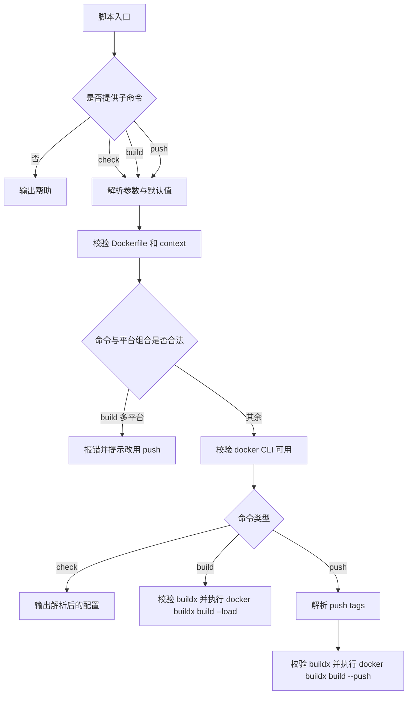

## Docker image 推送脚本说明

本项目发布 `linux/amd64` 与 `linux/arm64` 两个架构的多架构镜像，Docker 按机器的架构自动拉取对应的镜像。正式发布由 GitHub Actions 在两个架构的原生 runner 上分别构建、检查后按摘要推送，再合成清单（见下文“自动发布”）；本机手动 `push` 默认一次构建两个架构（非本机架构需要 QEMU）。

### 职责

| 命令 | 职责 | 输入 | 输出 | 依赖 | 关键约束 |
| --- | --- | --- | --- | --- | --- |
| `check` | 校验镜像推送所需配置 | CLI 参数、环境变量、`package.json` | 解析后的镜像配置与校验结果 | Node.js、Docker CLI、`Dockerfile` | 不执行构建或推送；不要求 buildx |
| `build` | 本地构建 Docker image | `--image` `--tag` `--extra-tags` `--platform` `--dockerfile` `--context` | `docker buildx build --load` 执行结果 | Docker CLI、buildx | 仅构建，不推送；`--load` 只支持单平台，多平台直接报错 |
| `push` | 构建并推送 Docker image | 同 `build`，另有 `--digest-file` | `docker buildx build --push` 执行结果 | Docker CLI、buildx、已登录的镜像仓库 | 单次构建即发布全部 tag；主 tag 不是 `latest` / `dev` 时，自动连带推送 `latest`。带 `--digest-file` 时只推送一个平台、不带 tag，把摘要写入该文件（发布流程用） |

### 输入解析

| 参数 | 默认值 | 说明 |
| --- | --- | --- |
| `--image` | `docker.io/lonemoonspace/weread-assistant` | 目标镜像仓库 |
| `--tag` | `package.json` 中的 `version` | 主 tag |
| `--extra-tags` | 空 | 额外 tag，使用英文逗号分隔 |
| `--platform` | `build`: 宿主平台；`check` / `push`: `linux/amd64,linux/arm64` | 目标平台，英文逗号分隔；会先去空白并去重 |
| `--dockerfile` | `Dockerfile` | 构建使用的 Dockerfile 路径 |
| `--context` | `.` | Docker build context |
| `--digest-file` | 空 | 仅 `push`，且只能有一个平台：按摘要推送（`push-by-digest`），不打 tag，摘要（`sha256:…`）写入该文件 |

### 流程



### 关键约束

| 约束 | 说明 |
| --- | --- |
| 两个架构 | 发布 `linux/amd64` 与 `linux/arm64`；`push` 未显式传 `--platform` 时两个都构建，单次 buildx 调用同时推送全部 tag，所有 tag 指向同一个多架构镜像 |
| 帮助优先 | 空参数或 `help/-h/--help` 仅输出帮助文本 |
| 默认最小化 | `build` 默认只处理一个主 tag；额外 tag 必须显式传入 `--extra-tags` |
| 版本来源 | 未传 `--tag` 时，主 tag 直接取 `package.json.version` |
| 版本发布补 latest | `push` 时如果主 tag 不是 `latest` 也不是 `dev`，自动把 `latest` 一起构建并推送 |
| `dev` 推送入口 | `npm run docker:image:push:dev` 固定把当前仓库实现推送到 `dev` tag |
| 显式失败 | 参数缺失、未知参数、构建命令在 Docker 或 buildx 不可用时、文件不存在时直接报错并退出 |
| 先校验参数后校验环境 | 非法的命令与平台组合在检查 docker 之前就报错，避免被「docker 不可用」掩盖 |
| check 不要求 buildx | `check` 只解析与校验配置，不执行构建，因此不会因为环境缺少 buildx 插件而失败 |
| build 仅单平台 | `build` 使用 `--load`，多平台无法载入本地镜像，直接报错并提示改用 `push` |
| 平台串归一化 | `--platform` 会去空白并去重后再转发；`buildx` 不会 trim，`containerd` 也会拒绝空白，原样转发只会在 buildx 内部才失败 |
| 镜像标签 | 名称、说明、源码地址与许可写在 `Dockerfile` 的 `LABEL` 中；`build` 与 `push` 另加 `org.opencontainers.image.version`（主 tag）与 `org.opencontainers.image.revision`（`DOCKER_REVISION`，未设置时取当前提交，没有 git 时省略） |

### 自动发布

`.github/workflows/release.yml` 在 GitHub Actions 中发布，不需要在本机推送：

| 触发 | 发布的 tag | 说明 |
| --- | --- | --- |
| `main` 分支的 CI 通过 | `dev` | 只处理本仓库 main 分支推送后的 CI，Pull Request 触发的 CI 不发布；构建的是 CI 通过的那个提交 |
| `main` 分支的 CI 通过，且 `package.json` 的版本还没有 tag | `0.1.0`、`latest`、`dev` | 即合并了改版本号的提交：在该提交上创建 tag `v0.1.0` 与 GitHub Release（说明为 `CHANGELOG.md` 中该版本的一节，没有时在构建前失败）；查询 tag 出错时失败，不当作新版本 |
| 推送版本 tag，如 `v0.1.0` | `0.1.0`、`latest` | tag 必须与 `package.json` 的 `version` 一致；同时用 `CHANGELOG.md` 中该版本的一节创建 GitHub Release |
| 手动运行（workflow_dispatch） | 在 `main` 上同 CI 通过时（版本已有 tag 时为 `dev`），在版本 tag 上为对应版本，在其他分支上只发布 `dev` | 其他分支上运行用于验证发布流程本身，不创建 tag 与 Release |

发布分三步（构建与合成见可复用的 `.github/workflows/image.yml`）：

1. 确定标签，检查发布说明与 Docker Hub 凭据。
2. amd64（`ubuntu-24.04`）与 arm64（`ubuntu-24.04-arm`）在原生 runner 上并行构建镜像，各自运行 `scripts/runtime-smoke.js`（`RUNTIME_SMOKE_ARCH` 为本架构）与内置浏览器的 `reader-smoke.js`，通过后用 `push --digest-file` 按摘要推送；两个架构都通过后，由汇总任务用 `docker buildx imagetools create` 合成多架构清单并打上全部 tag，再确认清单中两个架构都在。任何一个架构失败，tag 都不动。不再使用 QEMU。
3. 需要时创建 GitHub Release。

发布（`main`、版本 tag）与每周重建共用并发组 `release-latest`，依次运行，不会同时改动 `latest`。GitHub 每个并发组只保留一个排队中的运行，排队时又来了新的运行，旧的排队运行会被取消：`main` 上后来的提交会补上被取消的版本发布，被取消的 tag 发布或重建需要手动重新运行。

需要在仓库 Settings → Secrets and variables → Actions 中添加 `DOCKERHUB_USERNAME` 与 `DOCKERHUB_TOKEN`（Docker Hub 的 Personal access token，权限 Read & Write），缺少时发布在构建前失败并提示。

### 每周重建与漏洞扫描

`.github/workflows/rebuild.yml` 每周一 02:17 UTC 运行，也可以手动运行（可选“没有更新时也重建”）：

| 步骤 | 说明 |
| --- | --- |
| 检查 | 在已发布的 `latest` 中运行 `apk update` 与 `apk version -l '<'`，列出可以升级的系统包（如 Chromium 的安全更新）；比较镜像中与基础镜像当前的 Node.js 版本。结果写入工作流摘要 |
| 重建 | 有更新时检出最近一个正式版本的 tag（不是 `main`），用相同的源码按发布流程重新构建、检查两个架构，覆盖推送该版本号 tag 与 `latest`。期间已经发布了更新的版本、`latest` 指向的版本比这个新时，不改动 `latest`（版本号读自 `latest` 的 `org.opencontainers.image.version` 标签，多架构清单读不到时改读清单中第一个平台的镜像，见 `scripts/image-version.js`；仍读不到时也不改动，并在运行中给出警告）。最近的正式版本早于 0.4.0（没有按摘要推送的脚本）时只检查、不重建。因此固定版本号的用户也能拿到浏览器的安全更新 |
| 扫描 | 用 Trivy 扫描 `latest`，只列出已有修复版本的高危与严重漏洞，写入工作流摘要；有的话创建或更新 issue“镜像中有可修复的高危漏洞”（只报告，不阻断） |
| 基础镜像 | Docker Hub 上出现下一个 Alpine 稳定版的 Node.js 镜像（如 `node:24-alpine3.25`）时开 issue 提醒升级（Alpine 只在最新的稳定分支更新 Chromium） |

发布新版本：修改 `package.json` 的 `version`（并 `npm install --package-lock-only` 同步 lockfile），在 `CHANGELOG.md` 中加一节 `## <版本号>`，合并到 `main` 即可：CI 通过后工作流发现该版本还没有 tag，发布镜像并创建 tag 与 GitHub Release。工作流用 `GITHUB_TOKEN` 创建的 tag 不会再次触发发布。也可以照旧手动推送 tag：

```bash
git tag v0.1.0 origin/main
git push origin v0.1.0
```
