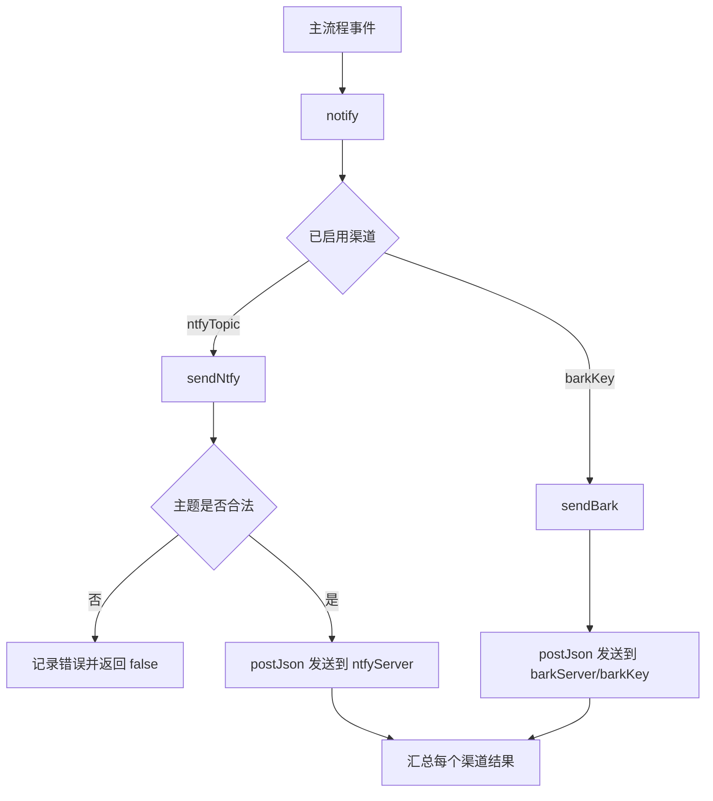

## 推送通知说明

通知相关的配置都在面板中设置（全局默认或账号覆盖），下文用括号注明配置项的字段名，见 `src/config/schema.js`。

### 职责

| 组件 | 职责 | 输入 | 输出 | 依赖 | 关键约束 |
| --- | --- | --- | --- | --- | --- |
| `notify(config, title, body, options)`（`src/notify/index.js`） | 统一推送入口，向所有已启用渠道并行发送 | 运行配置、标题、正文、渠道无关选项 | 每个渠道的成功/失败结果数组 | 已启用的渠道配置 | 单渠道失败不影响其他渠道，也不中断主流程 |
| `sendBark(config, title, body, options)`（`src/notify/bark.js`） | Bark 渠道实现（iOS） | 配置中的 `barkKey`、`barkServer` | Bark HTTP 请求结果 | `https` / `http` | 保持原有请求路径与负载字段不变 |
| `sendNtfy(config, title, body, options)`（`src/notify/ntfy.js`） | ntfy 渠道实现（Android 推荐） | 配置中的 `ntfy*` | ntfy HTTP 请求结果 | `https` / `http` | 主题非法时本地拦截，不发起请求 |
| `createNotifier(config, { loginLinkIntervalMs })`（`src/notify/index.js`） | 绑定一次运行的配置，提供 `event(name, body)`、`loginLink(url, qrImagePath)`、`willEmail(name)` | 运行配置 | 通知器对象 | 上述渠道与邮件 | 按事件开关推送；登录链接只在变化时推送，且受最小推送间隔限制 |
| `postJson(url, payload, headers)`（`src/shared/http.js`） | 渠道共用的 JSON POST 实现 | 目标地址、负载、附加请求头 | `{ ok, status, body, error }` | `https` / `http` | 带 15s 超时，超时/网络错误统一回落为失败结果 |

### 渠道与启用条件

| 渠道 | 适用平台 | 启用条件 | 服务端 |
| --- | --- | --- | --- |
| Bark | iOS | Bark Key（`barkKey`）非空 | 默认 `https://api.day.app`，可在 Bark 服务器地址（`barkServer`）中更换 |
| ntfy | Android / iOS / 桌面 | ntfy 主题（`ntfyTopic`）非空 | 默认 `https://ntfy.sh`，可在 ntfy 服务器地址（`ntfyServer`）中更换（支持自建） |
| 邮件 | 任意 | 启用邮件通知（`emailEnabled`），且 SMTP 服务器、SMTP 用户名、SMTP 密码、收件人都已填写 | 缺少配置时记录日志并跳过 |

### 通知事件

阅读流程只通过 `createNotifier(config).event(name, body)` 发送通知。标题为 `WeReadAssistant · <账号名称>`（面板中的账号名称；没有账号名称时为 `WeReadAssistant`）；副标题为事件名称。推送渠道与邮件都受同一个开关控制。

| 事件 | 开关（默认） | 触发时机 | 副标题 | level / sound |
| --- | --- | --- | --- | --- |
| `start` | 开始运行时通知（`notifyOnStart`，关） | 开始运行 | 开始运行 | `passive` / `beginning` |
| `loginRequired` | 需要扫码时通知（`notifyOnLoginRequired`，开） | 出现新的登录二维码 | 需要扫码 | `timeSensitive` / `birdsong` |
| `loginSuccess` | 登录成功时通知（`notifyOnLoginSuccess`，关） | 登录成功并打开书籍（仅登录模式下为保存 cookies 后） | 登录成功 | `active` / `birdsong` |
| `done` | 阅读完成时通知（`notifyOnDone`，开） | 阅读完成 | 阅读完成 | `active` / `success` |
| `failure` | 等待扫码超时或运行出错时通知（`notifyOnFailure`，开） | 等待扫码超时或运行出错 | 运行失败 | `critical` / `alarm` |

### 登录链接推送

| 渠道 | 内容 |
| --- | --- |
| Bark | 正文含登录链接，点击通知打开登录链接 |
| ntfy | 正文含登录链接，`click` 为登录链接，附「打开登录链接」按钮 |
| 邮件 | 内嵌页面上二维码的截图（`login-qr.png` 附件）与登录链接按钮 |

二维码约 1 分钟过期一次并自动刷新。同一链接只推送一次；两次推送至少间隔 3 分钟，期间刷新出的新链接不推送。二维码图片直接截取自页面，不再经过 `api.qrserver.com` 等第三方服务生成。

### 选项映射

主流程只调用 `notify`，渠道差异在渠道实现内部消化：

| `notify` 选项 | Bark 负载字段 | ntfy 负载字段 |
| --- | --- | --- |
| `title` | `title` | `title`（有 `subtitle` 时拼接为 `title · subtitle`） |
| `body` | `body` | `message` |
| `subtitle` | `subtitle` | 并入 `title` |
| `sound` | `sound` | 映射为 `tags`（`alarm→rotating_light`、`birdsong→bell`、`success→tada`、`beginning→rocket`） |
| `level` | `level` | 映射为数字 `priority`（`passive→2`、`active→3`、`timeSensitive→4`、`critical→5`；ntfy JSON 接口只接受 1-5 数字，字符串别名会导致 40024） |
| `url` | `url` | `click` |
| `image` | `image` | `attach`（外部图片 URL） |
| `group` | `group` | 忽略（ntfy 无分组概念） |
| `icon` | `icon` | `icon` |
| `actions` | 忽略 | `actions`（登录链接推送使用 `view` 按钮） |
| `markdown` | 忽略 | `markdown` |

### 覆盖项

| 配置项 | 作用 | 取值 |
| --- | --- | --- |
| ntfy 优先级覆盖（`ntfyPriority`） | 覆盖 level 到优先级的默认映射 | `1-5` 或 `min,low,default,high,urgent,max`（发送前统一归一化为 1-5 数字） |
| ntfy 标签覆盖（`ntfyTags`） | 覆盖 sound 到标签的默认映射 | 逗号分隔的标签列表 |
| ntfy Access Token（`ntfyToken`） | ntfy Access Token 认证 | `Authorization: Bearer <token>` |
| ntfy 用户名 + ntfy 密码（`ntfyUsername`、`ntfyPassword`） | ntfy Basic Auth 认证 | `Authorization: Basic <base64>`，仅在未配置 Token 时生效 |

### 流程

### 关键约束

| 约束 | 说明 |
| --- | --- |
| 未配置即静默 | 渠道未配置时 `notify` 只打印提示，不报错、不阻塞主流程 |
| 失败隔离 | 各渠道通过 `Promise.allSettled` 并发发送，单渠道异常只影响自身结果 |
| 请求超时 | 所有推送请求 15s 超时，避免推送服务无响应时拖住阅读流程 |
| 主题即密码 | ntfy 公共服务器上主题名等价于密码，仅允许 `[-_A-Za-z0-9]`，长度不超过 64 |
| 登录链接去重与限频 | 同一次运行中，`loginLink` 只在链接变化时推送，两次推送至少间隔 `loginLinkIntervalMs`（运行时为 3 分钟） |
| 事件开关 | 事件开关关闭时推送渠道与邮件都不发送 |
| 离线可验证 | `scripts/notify-smoke.js` 使用本地 mock 服务校验负载，不访问外网、不需要真实密钥 |
