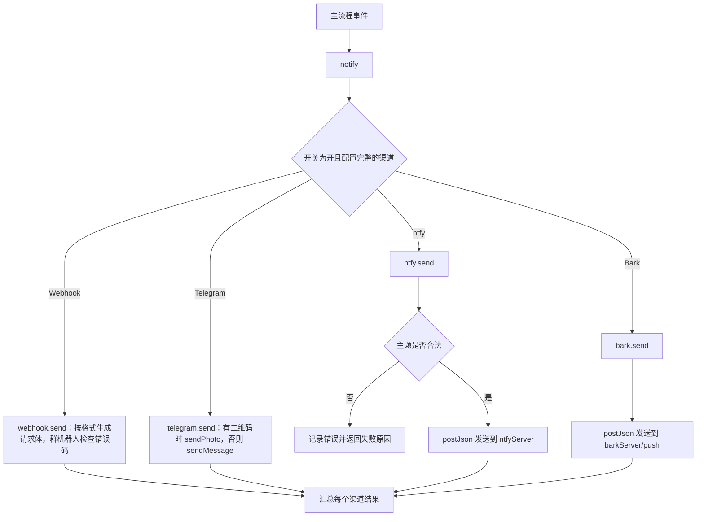

## 推送通知说明

通知相关的配置都在面板中设置（全局默认或账号覆盖），下文用括号注明配置项的字段名，见 `src/config/schema.js`。

### 职责

| 组件 | 职责 | 输入 | 输出 | 依赖 | 关键约束 |
| --- | --- | --- | --- | --- | --- |
| `notify(config, title, body, options)`（`src/notify/index.js`） | 统一推送入口，向所有实际启用的渠道并行发送 | 运行配置、标题、正文、渠道无关选项 | `[{ channel, ok, error }]`，`error` 为失败原因（不含密钥） | `src/notify/channels/` 中的渠道 | 单渠道失败或抛出异常只影响自身结果，不中断主流程 |
| 渠道列表 `CHANNELS`（`src/notify/channels/index.js`） | Bark、ntfy、Webhook、Telegram，按这个顺序发送与展示 | - | - | - | 每个渠道一个文件，导出相同的描述：`id`、`label`、按账号停用的开关 `toggle`、`isConfigured(config)`、`send(config, message)`（返回 `{ ok, error }`）；`message` 为统一的消息对象 `{ event, title, subtitle, body, level, sound, url, actions, photo }` |
| `channels/bark.js` | Bark（iOS） | `barkKey`、`barkServer` | 同上 | `https` / `http` | 使用 `POST /push`，Bark Key 放在请求体的 `device_key` 中，不出现在请求路径里 |
| `channels/ntfy.js` | ntfy（Android 推荐） | `ntfy*` | 同上 | `https` / `http` | 主题非法时本地拦截，不发起请求 |
| `channels/webhook.js` | 通用 Webhook 与企业微信、飞书、钉钉群机器人 | `webhookUrl`、`webhookFormat`、`webhookHeader` | 同上 | `https` / `http` | 地址与附加请求头按密钥处理，日志中只记录格式，不记录地址 |
| `channels/telegram.js` | Telegram 机器人 | `telegramBotToken`、`telegramChatId`、`telegramApiBase` | 同上 | Node 自带的 `fetch`、`FormData` | 令牌在请求路径中，日志与失败原因中都不出现 |
| `sendTestNotification(config)`（`src/notify/index.js`） | 面板“发送测试通知” | 运行配置 | `[{ channel, ok, error, disabled? }]` | 上述渠道与邮件 | 不受事件开关影响；已配置但在配置中关闭的渠道不发送，记为 `disabled: true`；邮件缺少配置时 `error` 列出缺少的项 |
| `createNotifier(config, { loginLinkIntervalMs })`（`src/notify/index.js`） | 绑定一次运行的配置，提供 `event(name, body)`、`loginLink(url, qrImagePath)`、`willEmail(name)`、`flush(timeoutMs)` | 运行配置 | 通知器对象 | 上述渠道与邮件 | 按事件开关推送；通知在后台发送，运行结束前 `flush` 最多等待 10 秒；登录链接只在变化时推送，且受最小推送间隔限制 |
| `postJson(url, payload, headers, timeoutMs)`（`src/shared/http.js`） | 渠道共用的 JSON POST 实现 | 目标地址、负载、附加请求头 | `{ ok, status, body, error }` | `https` / `http` | 推送渠道传入 10 秒时限（默认 15 秒），超时/网络错误统一回落为失败结果；支持 IPv6 地址；User-Agent 为 `WeReadAssistant/<版本>` |

### 渠道与启用条件

每个推送渠道有一个开关（`barkEnabled`、`ntfyEnabled`、`webhookEnabled`、`telegramEnabled`，默认都开）。渠道实际发送的条件是“开关为开并且配置完整”：全局默认中配置了 Bark 时，在某个账号的配置中关闭“启用 Bark 推送”，就只对这个账号停用。旧配置中没有这些字段，按开处理，行为与升级前一致。邮件仍由“启用邮件通知”（`emailEnabled`，默认关）控制。

| 渠道 | 适用平台 | 启用条件 | 服务端 |
| --- | --- | --- | --- |
| Bark | iOS | Bark Key（`barkKey`）非空 | 默认 `https://api.day.app`，可在 Bark 服务器地址（`barkServer`）中更换（末尾的斜杠会去掉）；请求发往 `<服务器地址>/push`，Bark Key 只在请求体中；服务器地址须以 `http://` 或 `https://` 开头，否则不发送并在日志中提示 |
| ntfy | Android / iOS / 桌面 | ntfy 主题（`ntfyTopic`）非空 | 默认 `https://ntfy.sh`，可在 ntfy 服务器地址（`ntfyServer`）中更换（支持自建） |
| Webhook | 任意 | Webhook 地址（`webhookUrl`）非空 | 填写的地址，格式见下文“Webhook” |
| Telegram | 任意 | 机器人令牌（`telegramBotToken`）与会话 ID（`telegramChatId`）都已填写 | 默认 `https://api.telegram.org`，访问不了时在 Telegram 接口地址（`telegramApiBase`）中填写自己的反向代理 |
| 邮件 | 任意 | 启用邮件通知（`emailEnabled`），且 SMTP 服务器、SMTP 用户名、SMTP 密码、收件人都已填写 | 缺少配置时记录日志并跳过；465 端口使用 SSL，其他端口要求 STARTTLS，服务器不支持时发送失败，只有开启「允许不加密的 SMTP 连接」（`emailAllowInsecure`）才以明文发送 |

### Webhook

| 配置项 | 说明 |
| --- | --- |
| Webhook 地址（`webhookUrl`） | 接收地址，按密钥处理（群机器人的地址中带 key）：接口返回掩码，日志中不出现 |
| Webhook 格式（`webhookFormat`） | `json`（通用 JSON，默认）、`wecom`（企业微信群机器人）、`feishu`（飞书群机器人）、`dingtalk`（钉钉群机器人） |
| Webhook 附加请求头（`webhookHeader`） | 可选的一个请求头，格式为 `名称: 值`，例如 `Authorization: Bearer xxx`；按密钥处理；不能改写 `Host`、`Content-Type`、`Content-Length`、`Transfer-Encoding`、`Connection`（保存配置时就拒绝） |

通用 JSON 的请求体：

```json
{
  "source": "WeReadAssistant",
  "version": "0.4.0",
  "event": "done",
  "account": "小明",
  "title": "WeReadAssistant · 小明",
  "subtitle": "阅读完成",
  "text": "阅读完成，共 68 分钟",
  "level": "active",
  "url": "",
  "time": "2026-11-15T14:00:00.000Z"
}
```

`event` 为下文的事件名，测试通知为 `test`；返回 2xx 即为成功。

三个群机器人格式都发送纯文本消息（`标题 · 副标题`、正文，有点击地址且正文中没有时附在最后）：企业微信与钉钉为 `{ "msgtype": "text", "text": { "content": "…" } }`，飞书为 `{ "msg_type": "text", "content": { "text": "…" } }`。它们出错时也返回 HTTP 200，所以按响应体判断：企业微信与钉钉看 `errcode`，飞书看 `code`（旧版为 `StatusCode`），为 0（数字或字符串）才算成功，否则失败原因为“错误码 N：说明”；响应体不是 JSON 对象时失败原因写明。

钉钉与飞书机器人的“加签”安全设置暂不支持，请在机器人的安全设置中选择“自定义关键词”（填 `WeReadAssistant`，每条消息的标题中都有）或 IP 白名单。

### Telegram

| 配置项 | 说明 |
| --- | --- |
| Telegram 机器人令牌（`telegramBotToken`） | 向 @BotFather 创建机器人后得到，按密钥处理 |
| Telegram 会话 ID（`telegramChatId`） | 接收消息的用户、群组（负数）或频道 ID，或公开频道的 `@用户名`；先给机器人发一条消息，机器人才能给你发消息 |
| Telegram 接口地址（`telegramApiBase`） | 默认 `https://api.telegram.org`，留空时同样用默认地址 |

普通事件用 `sendMessage` 发纯文本。需要扫码时用 `sendPhoto` 直接发送二维码截图（`login-qr.png`，推送时读入内存），说明文字为登录链接，并附「打开登录链接」「在面板中扫码」按钮，在电脑上收到也能用手机扫；发送图片失败时改发文字。按钮只用 http(s) 地址；按钮地址不被 Telegram 接受（例如局域网地址）时去掉按钮再发一次，链接已在正文中。去掉按钮与改发文字的重试都在同一个 10 秒时限内，时限到了就不再重试。上传图片用 Node 自带的 `fetch` 与 `FormData`，不增加依赖。令牌在请求路径中，日志不记录请求地址，失败原因中的令牌替换为掩码。

各渠道的失败原因都先把密钥（及其 URL 编码形式）替换为掩码，再截断到 200 字，跨过截断位置的密钥不会留下前一段。

### 通知事件

阅读流程只通过 `createNotifier(config).event(name, body)` 发送通知。标题为 `WeReadAssistant · <账号名称>`（面板中的账号名称；没有账号名称时为 `WeReadAssistant`）；副标题为事件名称。推送渠道与邮件都受同一个开关控制。

| 事件 | 开关（默认） | 触发时机 | 副标题 | level / sound |
| --- | --- | --- | --- | --- |
| `start` | 开始运行时通知（`notifyOnStart`，关） | 开始运行 | 开始运行 | `passive` / `beginning` |
| `loginRequired` | 需要扫码时通知（`notifyOnLoginRequired`，开） | 出现新的登录二维码 | 需要扫码 | `timeSensitive` / `birdsong` |
| `loginSuccess` | 登录成功时通知（`notifyOnLoginSuccess`，关） | 登录成功并打开书籍（仅登录模式下为保存 cookies 后） | 登录成功 | `active` / `birdsong` |
| `done` | 阅读完成时通知（`notifyOnDone`，开） | 阅读完成 | 阅读完成 | `active` / `success` |
| `failure` | 等待扫码超时或运行出错时通知（`notifyOnFailure`，开） | 等待扫码超时或运行出错 | 运行失败 | `critical` / `alarm` |
| `checkinWarning` | 晚间还没打卡时提醒（`notifyOnCheckinWarning`，开；时间 `checkinWarningAt`，默认 `21:30`） | 由面板的计划器发送：到提醒时间（面板时区）今天还不到 5 分钟，且没有正在进行、待执行或今天还会进行的运行（定时、重试、每日目标补跑），只提醒有启用的调度规则、每日目标或分段阅读的账号，每个账号每天最多一次；配置了 `PANEL_PUBLIC_URL` 时附账号页面的链接 | 今天还没打卡 | `timeSensitive` / `alarm` |
| `weeklyReport` | 每周阅读报告（`notifyOnWeeklyReport`，开；在“微信读书 API”分组，需要填写 API Key） | 由面板发送：每周一到面板设置 `weeklyReportAt`（默认 `09:00`，面板时区）之后，用微信读书 API 读取上周与前一周的阅读统计：阅读时长与天数、自然日均、与前一周相比、读得最多的 3 本书，以及上周新增的划线与想法（来自已同步的笔记）。每个账号每周一次；配置了 `PANEL_PUBLIC_URL` 时附账号笔记的链接（打开后切换到该账号的书库） | 上周阅读报告 | `passive` / `success` |

### 登录链接推送

| 渠道 | 内容 |
| --- | --- |
| Bark | 正文含登录链接，点击通知打开登录链接 |
| ntfy | 正文含登录链接，`click` 为登录链接，附「打开登录链接」按钮 |
| Webhook | 正文含登录链接；通用 JSON 的 `url` 为登录链接 |
| Telegram | 二维码截图，说明文字含登录链接，附「打开登录链接」「在面板中扫码」按钮 |
| 邮件 | 内嵌页面上二维码的截图（`login-qr.png` 附件，推送时读入内存）与登录链接按钮 |

面板先收到二维码（`login-required` 事件），推送随后在后台发送，推送慢或失败都不影响面板显示。二维码约 1 分钟过期一次并自动刷新。同一链接只推送一次；两次推送至少间隔 3 分钟，期间刷新出的新链接不推送。二维码图片直接截取自页面，不再经过 `api.qrserver.com` 等第三方服务生成。

### 选项映射

主流程只调用 `notify`，渠道差异在渠道实现内部消化（Webhook 与 Telegram 见上文）：

| `notify` 选项 | Bark 负载字段 | ntfy 负载字段 |
| --- | --- | --- |
| `title` | `title` | `title`（有 `subtitle` 时拼接为 `title · subtitle`） |
| `body` | `body` | `message` |
| `subtitle` | `subtitle` | 并入 `title` |
| `sound` | `sound` | 映射为 `tags`（`alarm→rotating_light`、`birdsong→bell`、`success→tada`、`beginning→rocket`） |
| `level` | `level` | 映射为数字 `priority`（`passive→2`、`active→3`、`timeSensitive→4`、`critical→5`；ntfy JSON 接口只接受 1-5 数字，字符串别名会导致 40024） |
| `url` | `url` | `click` |
| `image` | `image` | `attach`（外部图片 URL） |
| `group` | `group` | 忽略（ntfy 无分组概念） |
| `icon` | `icon` | `icon` |
| `actions` | 忽略 | `actions`（登录链接推送使用 `view` 按钮） |
| `markdown` | 忽略 | `markdown` |

### 覆盖项

| 配置项 | 作用 | 取值 |
| --- | --- | --- |
| ntfy 优先级覆盖（`ntfyPriority`） | 覆盖 level 到优先级的默认映射 | `1-5` 或 `min,low,default,high,urgent,max`（发送前统一归一化为 1-5 数字） |
| ntfy 标签覆盖（`ntfyTags`） | 覆盖 sound 到标签的默认映射 | 逗号分隔的标签列表 |
| ntfy Access Token（`ntfyToken`） | ntfy Access Token 认证 | `Authorization: Bearer <token>` |
| ntfy 用户名 + ntfy 密码（`ntfyUsername`、`ntfyPassword`） | ntfy Basic Auth 认证 | `Authorization: Basic <base64>`，仅在未配置 Token 时生效 |

### 流程



### 关键约束

| 约束 | 说明 |
| --- | --- |
| 未配置即静默 | 渠道未配置时 `notify` 只打印提示，不报错、不阻塞主流程 |
| 失败隔离 | 各渠道通过 `Promise.allSettled` 并发发送，单渠道异常只影响自身结果 |
| 请求超时 | 每个渠道一次发送限时 10 秒（含 Telegram 的重试） |
| 失败原因 | 每个渠道返回失败原因，面板“发送测试通知”逐个显示；原因中配置里的密钥值（4 个字符以上）替换为掩码 |
| 后台发送 | 阅读流程不等待通知发送完成；运行结束时（含失败）最多再等 10 秒，收到停止请求时只等 3 秒 |
| 主题即密码 | ntfy 公共服务器上主题名等价于密码，仅允许 `[-_A-Za-z0-9]`，长度不超过 64 |
| 登录链接去重与限频 | 同一次运行中，`loginLink` 只在链接变化时推送，两次推送至少间隔 `loginLinkIntervalMs`（运行时为 3 分钟） |
| 事件开关 | 事件开关关闭时推送渠道与邮件都不发送 |
| 离线可验证 | `scripts/notify-smoke.js` 使用本地 mock 服务校验负载，不访问外网、不需要真实密钥 |
