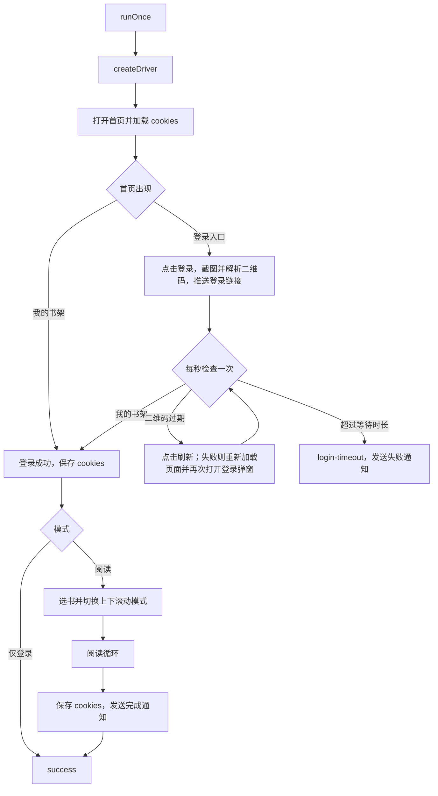

## 自动阅读流程说明

### 职责

| 组件 | 职责 | 关键约束 |
| --- | --- | --- |
| `src/reader/run.js` `runOnce(config, options)` | 编排一次运行：连接浏览器、登录、选书、阅读、通知 | 返回 `{ status, minutes, error }`，`status` 为 `success` / `login-timeout` / `error` / `stopped`；不退出进程 |
| `src/reader/worker.js` | 阅读子进程入口：由面板 fork，经 IPC 接收配置、上报事件 | 收到 SIGTERM / SIGINT 或与面板断开时关闭浏览器后退出 |
| `src/reader/browser.js` | 连接 `SELENIUM_URL` 中的 Chromium，设置超时与随机窗口尺寸 | 隐式等待为 0 |
| `src/reader/login.js` | 打开首页、加载 cookies、展示二维码、等待扫码、保存 cookies | 按总时长等待，期间二维码过期就刷新 |
| `src/reader/reading.js` | 选书、切换上下滚动模式、阅读循环 | 每轮一次 `executeScript` 读取页面状态 |
| `src/reader/selectors.js` | 页面地址、定位器与关键文案 | 微信读书改版时只改这里 |
| `src/reader/timing.js` | 由配置得出各类等待时间与翻动间隔 | 测试可通过 `options.timing` 覆盖 |
| `src/reader/dom.js` | 显式等待与批量检查元素的工具函数 | 替代隐式等待 |

### 运行模式

| 模式 | 入口 | 行为 |
| --- | --- | --- |
| 阅读（默认） | `node src/cli.js run` | 登录后选书并按 `WEREAD_DURATION` 阅读 |
| 仅登录 | `node src/cli.js run --login-only` | 登录并保存 cookies 后结束，用于刷新登录态 |

两种模式也可以在面板中触发，由面板 fork 阅读子进程执行，见下文与 `docs/panel.md`“运行队列”。

### 流程

### 阅读子进程与事件

面板为每次运行 fork 一个 `src/reader/worker.js`：面板发送 `{ type: "start", mode, config }`，子进程调用 `runOnce`，并把运行中的事件以 `{ event, data }` 发回面板。日志写到标准输出，由面板保存为运行目录中的 `output.log`；此时不在日志中打印二维码，二维码由面板页面显示。

| 事件 | 时机 | `data` |
| --- | --- | --- |
| `started` | 子进程收到配置 | `version` |
| `session` | 浏览器会话建立 | `sessionId`，面板强制结束子进程时用它清理 Selenium 会话 |
| `login-required` | 每次截取二维码（含二维码刷新后） | `url`：解析出的登录链接，解析失败时为空 |
| `login-ok` | 登录成功（包括 cookies 仍然有效、不需要扫码时） | - |
| `login-timeout` | 等待扫码超时 | - |
| `book-opened` | 打开书并切换到上下滚动模式 | `title`：书名，取不到时为空 |
| `reading-minute` | 阅读中每分钟 | `minute`、`total`（计划分钟数）、`screenshot`（截图文件名，未开启截图时为空） |
| `done` | 完成（仅登录模式在保存 cookies 后） | `minutes` |
| `error` | 运行出错 | `message` |

`runOnce` 接收 `options.signal`（`AbortSignal`）。停止时立即关闭浏览器，正在执行的 WebDriver 命令随之失败，两次翻动之间、等待扫码的轮询等较长的等待也会立即结束；运行以 `stopped` 结束，不上报 `error`、不发送失败通知。浏览器正在连接时收到停止，连接完成后立即关闭。

### 阅读循环

每轮先等待一个随机翻动间隔，再用一次 `executeScript` 读取页面标题与各元素状态，然后按以下顺序处理：

| 顺序 | 条件 | 动作 |
| --- | --- | --- |
| 1 | 标题含“已读完”、出现“开通后即可阅读”或“全 书 完” | 打开目录，点第 2 个条目（只有一项时点这一项），回到书的开头附近 |
| 2 | “下一章”/“下一页”按钮完整出现在视口内 | 点击 |
| 3 | 出现“点击重试” | 点击 |
| 4 | 其他 | 按住方向键下 50–500 毫秒 |

每分钟截图一次（`WEREAD_SCREENSHOT`）。截图小于 100KB 视为白屏并刷新页面：阅读页正文由 canvas 绘制，无法通过 DOM 文本判断是否白屏。

### 翻动节奏

| `WEREAD_SPEED` | 翻动间隔 |
| --- | --- |
| `slow`（默认） | 13–19 秒 |
| `normal` | 8–12 秒 |
| `fast` | 4–8 秒 |

旧版设置了 5 秒隐式等待，每轮对不存在元素的检查都会被拖慢，实测每轮 10–15 秒，`WEREAD_SPEED` 原有的 0.1–1 秒随机间隔实际上不起作用。现在去掉了隐式等待，翻动节奏完全由上表决定，默认的 `slow` 与旧版的实际节奏接近。

### 关键约束

| 约束 | 说明 |
| --- | --- |
| 隐式等待为 0 | 元素不存在时立即返回；需要等元素出现的地方（首页入口、书架、切换按钮、目录条目）使用显式等待 |
| 等待扫码 | 由 `WEREAD_LOGIN_TIMEOUT`（分钟，默认 15）控制；二维码约 1 分钟过期，期间自动刷新，不限次数 |
| cookies | 先写临时文件再重命名；读取时内容损坏则改名为 `cookies.json.corrupt-<时间戳>` 并转入扫码；单个 cookie 加载失败只跳过该条 |
| 登录二维码 | `login.png` 为整页截图，`login-qr.png` 为二维码区域截图（用作邮件附件） |
| 首页校验 | 首页标题不是“微信读书”时报错 |
| 书名 | 从阅读页标题“书名 - 作者 - 微信读书”中解析，取不到时为空 |
| 日志 | `util.format` 格式化；`console.debug` 只在 `DEBUG=true` 时输出 |
| 停止 | 面板中停止或进程收到 SIGTERM / SIGINT 时关闭浏览器后结束，见“阅读子进程与事件” |
