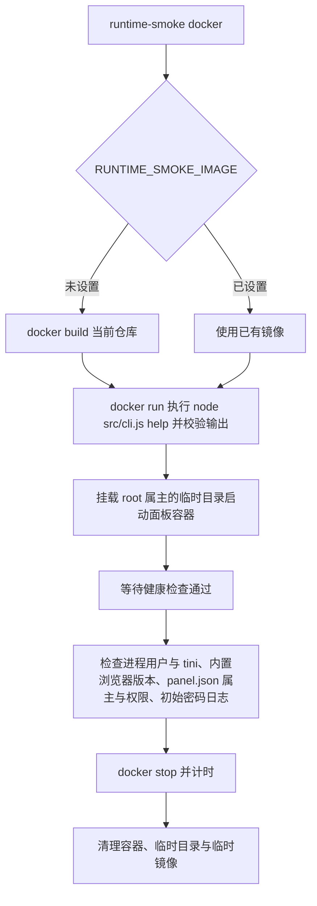

## 运行 Smoke 说明

### 职责

| 组件 | 职责 | 输入 | 输出 | 依赖 | 关键约束 |
| --- | --- | --- | --- | --- | --- |
| `scripts/runtime-smoke.js docker` | 验证当前 `Dockerfile` 构建出的镜像：CLI 可运行，面板健康检查通过、以 `node` 用户在 tini 下运行、内置浏览器可用、数据文件属主正确、能及时停止 | 当前仓库源码、Docker daemon | 构建日志、通过/失败状态 | Docker | 不依赖扫码登录或 Selenium |

### 流程

### 关键约束

| 约束 | 说明 |
| --- | --- |
| 验证边界 | 只验证镜像入口与面板启动，不做真实登录、扫码或阅读 |
| 容器来源 | 默认基于当前工作树里的 `Dockerfile` 本地构建；设置 `RUNTIME_SMOKE_IMAGE` 时直接使用该镜像，结束后不删除 |
| 架构 | 设置 `RUNTIME_SMOKE_ARCH`（如 `arm64`）时，镜像的架构与容器内 Node.js 报告的架构都必须与之一致（Node.js 把 amd64 报告为 `x64`）；CI 在 QEMU 中运行 arm64 镜像时用它确认检查的确实是发布的架构 |
| 校验关键字 | 帮助输出需包含 `src/cli.js run`、`help`、`SELENIUM_URL` 与 `PANEL_PORT` |
| 健康检查 | 运行时把检查间隔缩短为 2 秒，60 秒内需变为 `healthy` |
| 运行用户 | 1 号进程是 tini 且属于 `node`，以 `--user node` 启动时 1 号进程同样是 tini；`/app/data/panel.json` 属于 `node` 且权限为 600 |
| 内置浏览器 | 在容器中运行 `chromium-browser --version` 与 `chromedriver --version`（经 `src/shared/local-browser.js`），两者主版本一致，输出以 `Chromium <版本>` 开头 |
| 停止耗时 | `docker stop` 需在 5 秒内完成，说明面板正确处理了 SIGTERM |
