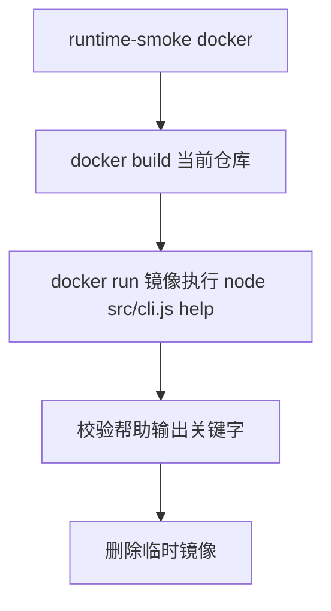

## 运行 Smoke 说明

### 职责

| 组件 | 职责 | 输入 | 输出 | 依赖 | 关键约束 |
| --- | --- | --- | --- | --- | --- |
| `scripts/runtime-smoke.js docker` | 验证当前 `Dockerfile` 构建出的镜像可正常启动 CLI | 当前仓库源码、Docker daemon | 镜像构建日志、容器帮助输出、通过/失败状态 | Docker | 通过 `docker run --rm <image> node src/cli.js help` 验证镜像内 CLI，不依赖扫码登录或 Selenium |

### 流程

### 关键约束

| 约束 | 说明 |
| --- | --- |
| 验证边界 | 只验证"入口可执行"，不做真实登录、扫码或阅读 |
| 容器来源 | 基于当前工作树里的 `Dockerfile` 本地构建镜像 |
| 校验关键字 | 帮助输出需包含 `src/cli.js run`、`help` 与 `SELENIUM_URL` |
| 清理规则 | 结束后删除临时镜像 |
